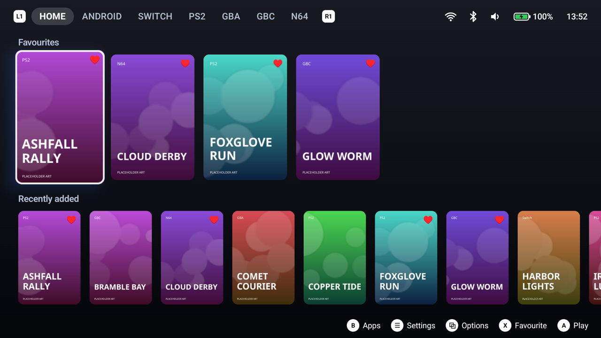
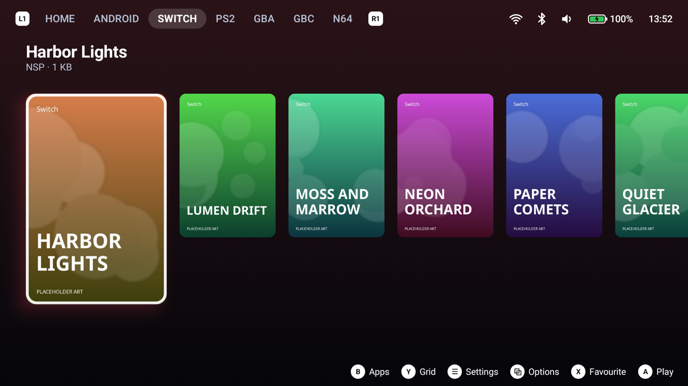
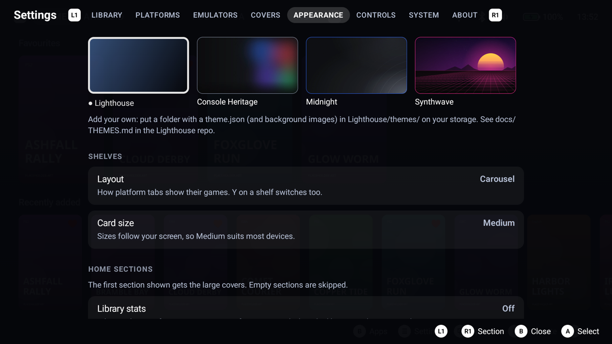
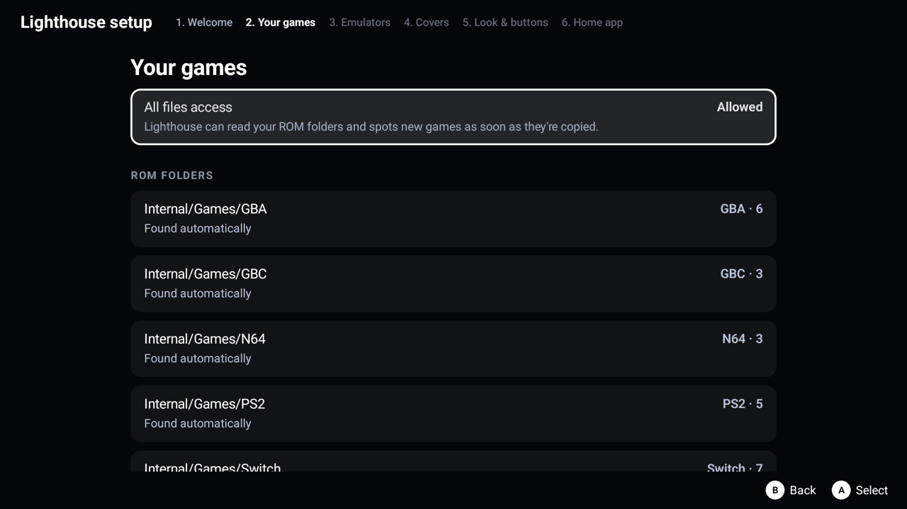

# Lighthouse

An open-source, controller-first game launcher for Android handhelds.

Lighthouse puts your emulated games, Android games, PC games and streaming in one library. Each platform gets its own tab, switched with the shoulder buttons, and a console-style HOME page sits in front of them all. It's built to be driven entirely from a controller. It has **no analytics or tracking**, and needs **no root** (root unlocks a few optional extras).

> **Status:** v0.1.3, early but usable. Developed and used daily as the Home app on an AYN Odin 2 Portal. It's also tested on emulators at the screen sizes of other popular handhelds (Odin 2 / Mini, Retroid Pocket 5 / Mini, Anbernic 4:3 and square). Expect rough edges, and please [report them](../../issues).



| | |
|---|---|
|  |  |
| A platform tab (carousel view; Y switches to a grid) | Settings, fully controller-driven: themes and layout |
|  | |
| First-run setup finds your ROM folders | |

<sub>Screenshots use made-up games with placeholder art.</sub>

## Features

**Your library, found for you**
- Detects platform folders under `Games/`, `ROMs/` or `Emulation/` on internal storage and SD cards, and watches them: copy a game in and it appears within seconds.
- Platforms: **Switch, PS2, GBA, GBC/GB, N64**, plus your **Android games and apps**.
- Cleans up No-Intro style names, skips BIOS files, keys, saves and Switch updates/DLC, and collapses duplicate copies across storage.

**PC games and streaming**
- **DroidDeck** and **GameNative**: both apps keep a folder of one-file-per-game shortcuts in sync, and Lighthouse lists those games on their own tabs and launches them directly (Steam, Epic, GOG, Amazon and custom games).
- **Moonlight**: the games on your PCs (Sunshine/GameStream) get a Moonlight tab and an "On your PC" HOME row, with box art from your PC. A launches straight into the stream, and Moonlight wakes the PC first if needed. Reading the game list needs root; without root, use Moonlight's own "Create shortcut" on a game.
- **Shortcuts from any app**: "Create shortcut" / "Add to home screen" lands on a Shortcuts tab.

**Launching**
- One button to play, using per-emulator launch profiles: **Eden** (Switch), **ARMSX2** (PS2), **RetroArch** with mGBA (GBA/GBC) and Mupen64Plus-Next (N64), **DroidDeck**, **GameNative**. You can choose the emulator per platform.
- Clear fixes when something's missing: emulator not installed, no storage permission, RetroArch core not downloaded.

**Covers**
- Your own images first (a picture named like the ROM, or in `Lighthouse/covers/<platform>/`).
- Then, if you allow it: libretro box art, or SteamGridDB with a free API key. You can send the key from your phone by scanning a QR code.
- A cover picker for anything you want to change.

**HOME and navigation**
- HOME page rows: Favourites, Continue playing, Recently added, Streaming, On your PC, Platforms. Reorder or hide any of them.
- Carousel or grid per tab, and three card sizes that scale with your screen.
- Quick settings in the top bar (Wi-Fi, Bluetooth, volume, battery saver). With root, Wi-Fi, Bluetooth and battery saver switch silently.
- Can be your **default Home app**: Back never leaves Lighthouse, and the Home button always returns to HOME.
- Themes: four built in, or [write your own](docs/THEMES.md) with a `theme.json` and background images.

## Controls

| Button | Action |
|---|---|
| D-pad / stick | Move |
| A | Play / select |
| B | All apps (on a shelf), back (anywhere else) |
| X | Favourite |
| Y | Carousel ↔ grid |
| L1 / R1 | Previous / next tab |
| Start | Settings |
| Select (or long-press) | Game options: cover, favourite, hide |
| Home | Back to HOME |

Settings → Controls has a Nintendo-style layout that swaps A and B everywhere.

## Install

Requires **Android 11 or newer**.

1. Download the latest `lighthouse-<version>.apk` from [Releases](../../releases) and install it, or add this repository to [Obtainium](https://github.com/ImranR98/Obtainium) to get updates automatically.
2. Open Lighthouse. First-run setup finds your games and emulators, offers covers, and can make Lighthouse your Home app.
3. Allow **All files access** when asked: that's how Lighthouse reads your ROM folders and notices new games.

To check a download, see [Verifying a release](SECURITY.md#verifying-a-release).

## Privacy

Lighthouse has no analytics, accounts, ads or tracking. It only goes online when you ask it to fetch covers (libretro, and SteamGridDB with your own key). "Send from phone" runs a short-lived HTTPS page on your local network, only while that screen is open.

## Building

Requires JDK 21 and the Android SDK (API 37).

```bash
./gradlew testSideloadDebugUnitTest      # unit tests
./gradlew assembleSideloadProfile        # release-optimised, debug-signed (judge smoothness on this)
scripts/deploy.sh [sideload|play] [profile|debug]   # build, install and launch on a USB device
```

| Flavour | Storage | Folder watching | Distribution |
|---|---|---|---|
| `sideload` | All files access | Instant (file observers) | GitHub Releases, Obtainium |
| `play` | Folders you pick | Rescans | A possible future Play Store build |

| Build type | Use |
|---|---|
| `debug` | Fast to build, slow to run ("Lighthouse Debug", ID suffix `.debug`) |
| `profile` | Release-optimised, debug-signed (ID suffix `.profile`) |
| `release` | Minified and release-signed: what's published |

CI builds both flavours and fails if the `play` APK ever requests `MANAGE_EXTERNAL_STORAGE`. Device-size testing on headless emulators: see [`scripts/compat/`](scripts/compat/).

### Project layout
```
app/src/main/java/io/cttech/lighthouse/
  library/       platforms, folder detection, ROM scanning, apps, Moonlight, pinned shortcuts
  launch/        launch profiles (assets/launch_profiles.json) and the launcher
  covers/        cover sources (local, libretro, SteamGridDB) and storage
  data/db/       Room database; schemas in app/schemas/
  system/        settings, Wi-Fi/Bluetooth/battery, optional root helper
  ui/            HOME, shelves, settings, setup, pop-ups, theming
tools/themegen/  generator for the bundled theme backgrounds
```

## Contributing

Issues and pull requests are welcome; see [CONTRIBUTING.md](CONTRIBUTING.md). New emulator support is usually just a launch profile in `app/src/main/assets/launch_profiles.json`.

## Security

Please report security problems privately; see [SECURITY.md](SECURITY.md).

## Licence

GPL-3.0-or-later. See [LICENSE](LICENSE).

Lighthouse is an independent project, written from scratch. It isn't affiliated with, and contains no code or assets from, any other launcher. It doesn't include any games, BIOS files or emulators.

Nintendo Switch, PlayStation 2, Game Boy Advance, Steam and other product names are trademarks of their owners. They're used only to describe compatibility; Lighthouse isn't affiliated with or endorsed by them. Bundled open-source libraries are listed in [NOTICE](NOTICE) and in the app (Settings → About).
